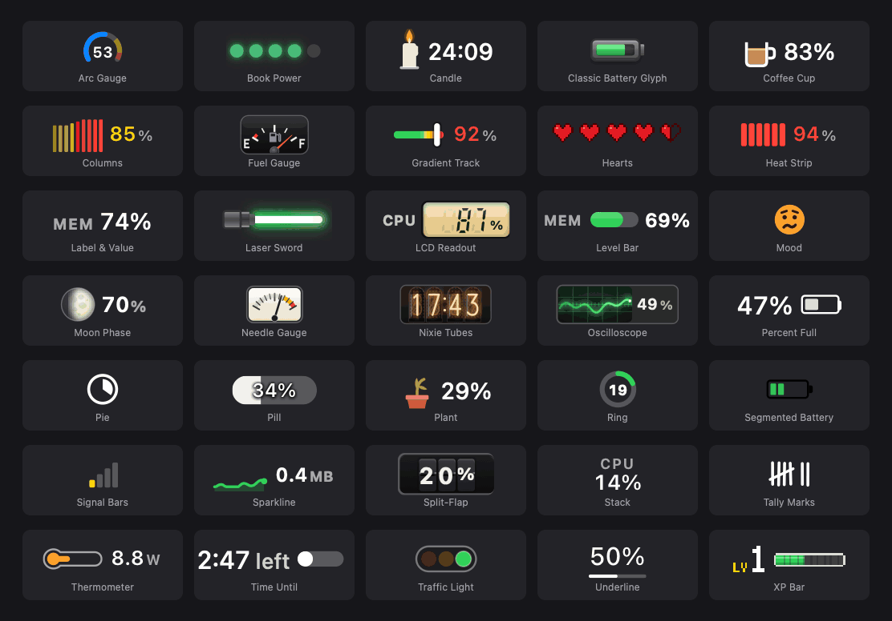

# Multimeter faces

Every meter in [Multimeter](https://multimeterapp.com/?ref=github-faces), the Mac menu bar app, is drawn by a face: a small folder with an HTML file, a stylesheet and a script. These are the 35 faces that ship with the app, plus two examples to start from.

## The faces

| Face | What it looks like |
|------|--------------------|
| [Arc Gauge](faces/arc) | A flat open gauge that sweeps around the number. |
| [Book Power](faces/book-power) | Five dots that light up as the battery fills. |
| [Candle](faces/candle) | A candle that burns down as your time runs out. |
| [Classic Battery Glyph](faces/classic-battery) | A simple battery icon. |
| [Coffee Cup](faces/coffee) | A mug of coffee that empties as the level drops, steaming while it charges. |
| [Columns](faces/columns) | A small bar chart of the last minute, one column per reading. |
| [Fuel Gauge](faces/fuel-gauge) | A car dash gauge from E to F that shows how much is left. |
| [Gradient Track](faces/gradient-track) | A green to red scale with a marker where the value sits. |
| [Hearts](faces/hearts) | A row of hearts, like a game health bar. |
| [Heat Strip](faces/heat-strip) | Recent readings as a row of cells that get brighter as the value climbs. |
| [Label & Value](faces/label-value) | Just the words: a small label and the value. |
| [Laser Sword](faces/laser-sword) | A glowing blade that shrinks as the battery drains. |
| [LCD Readout](faces/lcd-readout) | Seven-segment digits on a backlit LCD, like a bench multimeter. |
| [Level Bar](faces/level-bar) | A label, a bar that fills, and the value. |
| [Mood](faces/mood) | A little face that smiles while things are fine and worries when they aren't. |
| [Moon Phase](faces/moon) | A moon that waxes from new to full as the value climbs. |
| [Needle Gauge](faces/needle-gauge) | A little analog panel meter with a springy needle. |
| [Nixie Tubes](faces/nixie) | Warm orange numbers glowing in little glass tubes. |
| [Oscilloscope](faces/oscilloscope) | A green phosphor trace of the last couple of minutes on a lab scope screen. |
| [Percent Full](faces/percent-full) | Counts up while charging, down when not. |
| [Pie](faces/pie) | A small pie that fills in, readable at a glance without a number. |
| [Pill](faces/pill) | A capsule that fills like a Control Center slider, with the value inside. |
| [Plant](faces/plant) | A potted plant that blooms while things are good and wilts as they get worse. |
| [Ring](faces/ring) | A ring that closes as the value climbs, with the number inside. |
| [Segmented Battery](faces/segmented-battery) | Battery outline with five segments. |
| [Signal Bars](faces/signal-bars) | Four bars that rise with the value, like Wi-Fi strength. |
| [Sparkline](faces/sparkline) | A live graph of the last couple of minutes, with the value beside it. |
| [Split-Flap](faces/split-flap) | Flip-card characters like an old train station board. |
| [Stack](faces/stack) | A tiny label stacked over the value, so both fit in one narrow slot. |
| [Tally Marks](faces/tally) | Hand-drawn tally marks in groups of five, for counting the things you send it. |
| [Thermometer](faces/thermometer) | A thermometer whose mercury rises with the value, from cool to hot. |
| [Time Until](faces/time-until) | Time left on battery, or until full while charging. |
| [Traffic Light](faces/traffic-light) | Three lamps: green while all is well, yellow at the warning level, red when it's critical. |
| [Underline](faces/underline) | The value as plain menu bar text, with a thin line underneath that fills. |
| [XP Bar](faces/xp-bar) | A pixel-art level and experience bar that levels up as your count grows. |

Starting points for your own face live in [`examples/`](examples): [`starter`](examples/starter) (a label, a bar and the value) and [`history-graph`](examples/history-graph) (a graph of recent readings).

## Use one

Faces ship with Multimeter. To try a changed copy: zip the folder, rename the `.zip` to `.multimeter`, and double-click it (or use Import… in Settings, Command-O). It's added next to the original, so you can switch back any time.

## Make your own

1. In Multimeter's Settings, click **Create Face…** (Option-Command-N).
2. Edit `index.html`, `styles.css` and `meter.js`. Quit and reopen Multimeter to see your changes.
3. Share it: zip the folder, rename it to `.multimeter`, and submit it to the [gallery](https://multimeterapp.com/gallery?ref=github-faces).

Each face gets `window.meterData` (value, level from 0 to 1, formatted text, label, unit, state, tint, recent history and more) and a `meterUpdate` event whenever it changes. `manifest.json` names the face, its width and the sources it works with.

- Tutorial: https://multimeterapp.com/guides/build-a-face?ref=github-faces
- Every field a face receives: https://multimeterapp.com/creating-meters?ref=github-faces

One tip from building these: animate with a short timer (the built-in faces tween at 30 fps) instead of CSS transitions on values that change often. A transition keeps the menu bar redrawing at the display's full refresh rate and costs real battery.

## License

MIT for everything in this repo (see [LICENSE](LICENSE)). Multimeter itself is a paid Mac app from Great Work: [multimeterapp.com](https://multimeterapp.com/?ref=github-faces).
